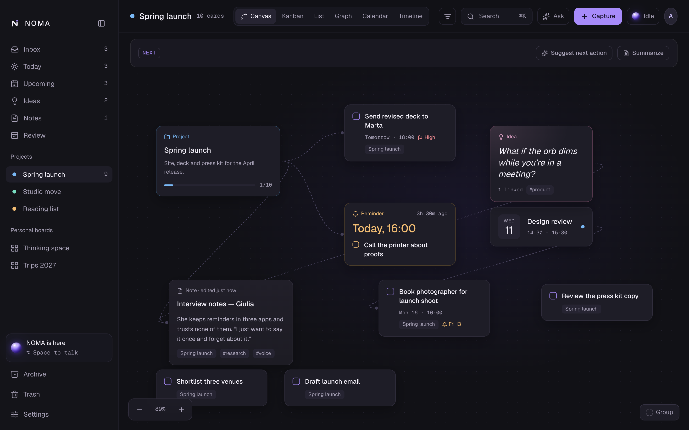
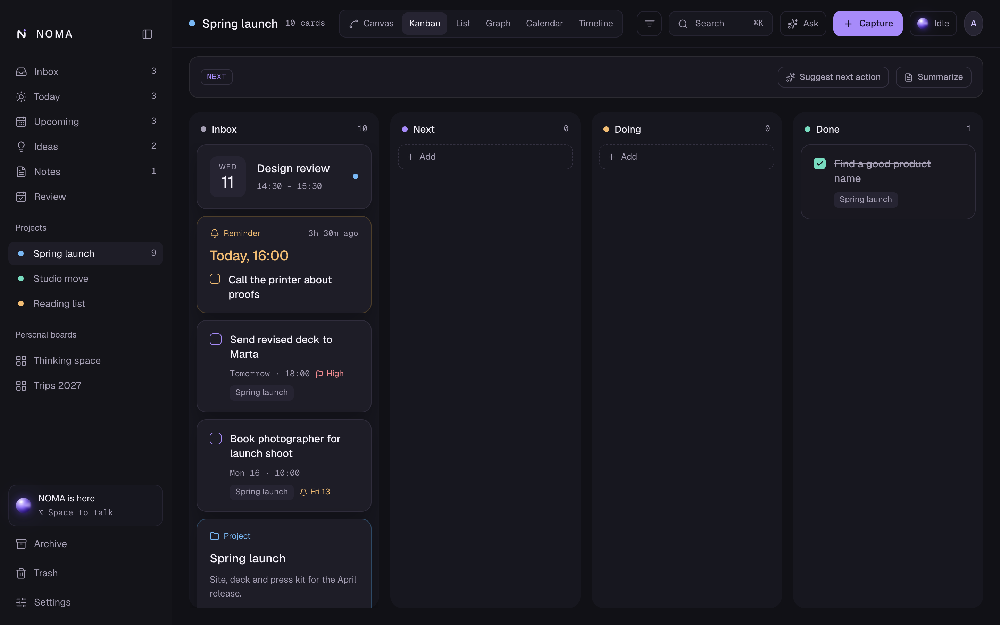
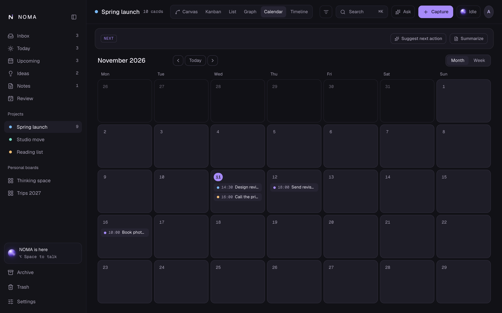
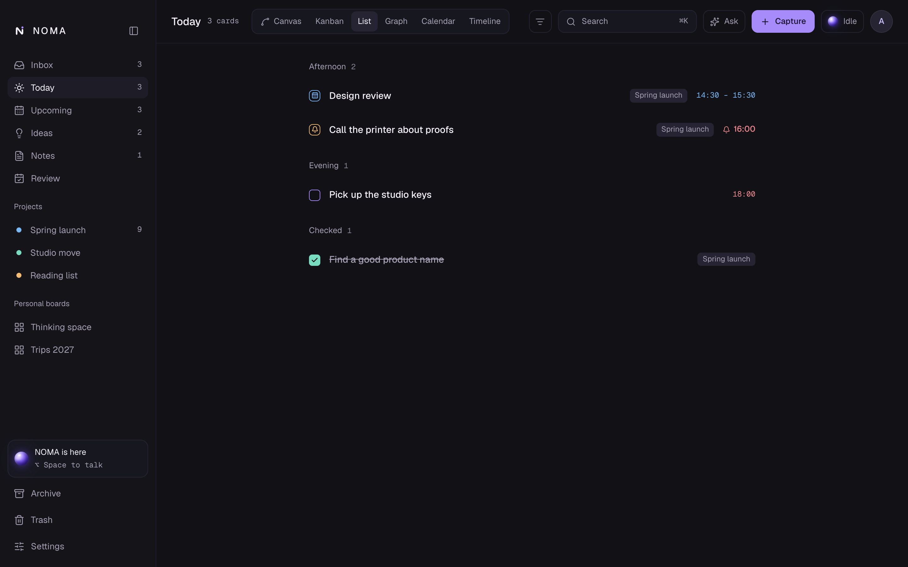
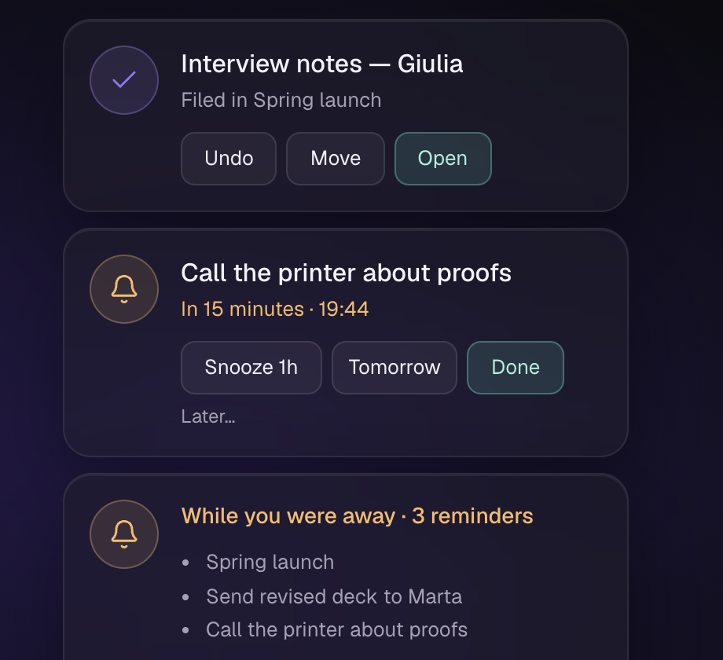

<div align="center">

# NOMA

**YOUR SECOND MIND.**

Say it once. NOMA files it.
A private AI companion for your Mac that turns what you say or type into tasks, reminders, notes and ideas, on the right board, with the right date. Everything runs on your machine.

[](https://github.com/alemastro97/noma/actions/workflows/ci.yml)




</div>

## What it is

A small violet orb lives on your desktop. Hold **⌥ Space** anywhere, say what is on your mind, and let go. A moment later a card appears where it belongs:

> "Remind me to send Marta the revised deck tomorrow evening, it's for the spring launch."
> → a **reminder** card, due tomorrow 18:00, high priority, in the **Spring launch** project.

No forms, no folders to choose, no cloud account. The speech recognition and the language model both run locally, and your cards live in a SQLite file on your Mac.

## Highlights

**Capture without friction**

- **Hold to talk** from any app, even over fullscreen windows. Release to save. Voice and quick-capture shortcuts are rebindable with a live recorder.
- **Italian and English**, including mixed notes. Whisper runs on the Metal GPU and your own project names are fed to it, so they are recognized.
- **Quick capture** (⌘⇧N) for typing, the ⌘K palette, a `noma` terminal command and `noma://` links for Shortcuts, Raycast or Alfred.

**It understands and files**

- Each capture becomes one or more typed cards: task, reminder, note, idea, event or project, with a short title, due date, reminder, repeat rule and priority.
- It picks the right **project or personal board** by topic, and **links related cards**. When unsure, it goes to the Inbox.
- A small **toast tells you where it went**, with Undo and Move. When you move a card, NOMA **learns** and files similar notes the same way next time.
- **Voice commands**: "segna fatto chiamare Marta", "sposta il dentista a domani", "cosa ho oggi?".

**A workspace to think in**

- Five ways to look at a project: **Canvas**, **Kanban**, **List**, **Calendar** and **Timeline**, plus a **Graph** of how your cards link.
- Checklists, attachments, Markdown notes, pinned cards, Archive and Trash, multi-select, global undo/redo, saved filters, habits with streaks and a focus timer.
- **Ask NOMA** and search by meaning, powered by a small local embedding model.
- Summaries, a suggested next action per project, a weekly **Review** and a **Re-sort Inbox** button.

**Reminders that respect you**

- Toasts with Snooze, Tomorrow, Done and a custom snooze, plus a morning brief and an evening recap.
- Reminders missed while your Mac slept are grouped as **While you were away**. Quiet hours, pause and per-reminder offsets are built in.

<table>
  <tr>
    <td width="50%"></td>
    <td width="50%"></td>
  </tr>
  <tr>
    <td width="50%"></td>
    <td width="50%"></td>
  </tr>
</table>

## Private by design

- **Local models.** Speech-to-text ([whisper.cpp](https://github.com/ggml-org/whisper.cpp)) and the language model ([llama.cpp](https://github.com/ggml-org/llama.cpp)) run on your Mac. Nothing you say or write is sent anywhere.
- **Local data.** Cards live in one SQLite file. Daily backups (the last 10 are kept), restore, and export to Markdown and JSON are built in.
- **The only network use** is downloading the models once, from Hugging Face and GitHub Releases, each pinned by URL and SHA-256 and checked after download.
- **Light at rest.** About 0.2 GB of memory while idle. The speech model loads only while you speak and the language model only while it works; both are released after a few minutes.

| Model                                     | Size       | Role                   |
| ----------------------------------------- | ---------- | ---------------------- |
| Qwen3 4B Instruct (default), 1.7B or 8B   | 1–5 GB     | Understands your notes |
| Whisper large v3 turbo (default) or small | 0.2–0.6 GB | Hears you              |
| EmbeddingGemma 300M (optional)            | 0.3 GB     | Search by meaning      |

## Install

> **Status:** NOMA is a personal project in active development, macOS only. The v0.3.0 download does not yet include the features added since. To get everything, build from source.

**Requirements:** macOS 13 or later. Apple Silicon is recommended (the models use Metal); 16 GB of RAM is comfortable for the default models.

**Build from source** (needs Node 22, pnpm 10, Rust stable and the Xcode Command Line Tools):

```bash
git clone https://github.com/alemastro97/noma.git
cd noma
pnpm install
pnpm tauri build      # or: pnpm tauri dev
```

On first launch NOMA walks you through downloading the two models and trying **⌥ Space**.

**Prebuilt app:** tagged releases (`v*`) are built on GitHub Actions as a universal macOS DMG, under [Releases](https://github.com/alemastro97/noma/releases). They are **unsigned**, so macOS blocks the first launch. Either right-click the app and choose Open, or run:

```bash
xattr -dr com.apple.quarantine /Applications/NOMA.app
```

NOMA stays in the menu bar when you close the window or press ⌘Q, so ⌥ Space keeps working. Use **Quit NOMA** in the menu bar to exit. Installed builds turn on _Open at login_ the first time; you can switch it off in Settings.

## Keyboard

| Shortcut   | Does                                       |
| ---------- | ------------------------------------------ |
| ⌥ Space    | Hold to talk, release to save (rebindable) |
| ⌘⇧ N       | Quick capture from anywhere (rebindable)   |
| ⌘ K        | Command palette and search                 |
| ⌘ F        | Filter the current view                    |
| ⌘ Z / ⇧⌘ Z | Undo / redo                                |
| ⌘ 1–4      | Canvas, Kanban, List, Graph                |

## For developers

```bash
pnpm dev            # the UI alone, in a browser, with a mock backend
pnpm tauri dev      # the full desktop app
pnpm test           # frontend tests (Vitest)
pnpm lint && pnpm typecheck
cd src-tauri && cargo test && cargo clippy --all-targets -- -D warnings
cargo run --release --example eval   # capture quality eval (48 notes)
```

Debug builds include an end-to-end self-test that speaks Italian sentences through Whisper and the local model on a throwaway database: `NOMA_SELFTEST_DB=/tmp/x.db pnpm tauri dev`.

**Stack:** Tauri 2 (Rust) · React 19 · TypeScript · Vite · SQLite (`rusqlite`) · whisper.cpp · llama.cpp.

The project is **spec-driven**: every feature has a living spec with a changelog.

- [Spec index](docs/specs/README.md) and the [design document](docs/specs/2026-11-09-noma-design.md)
- [Architecture decisions](docs/adr/README.md)
- [Design handoff](design/README.md): tokens, the orb and screen mockups; normative for the UI
- [Backlog](docs/backlog.md) and the [changelog](CHANGELOG.md)

Releases: bump the version in `package.json`, `src-tauri/Cargo.toml` and `src-tauri/tauri.conf.json`, add a changelog entry, then `git tag vX.Y.Z && git push --tags`.

## License

[PolyForm Noncommercial 1.0.0](LICENSE). You can read, run, learn from and modify the source for personal and other noncommercial use. Selling it, or using it in a commercial product or service, needs the author's permission.

Third-party models and programs keep their own licenses.
